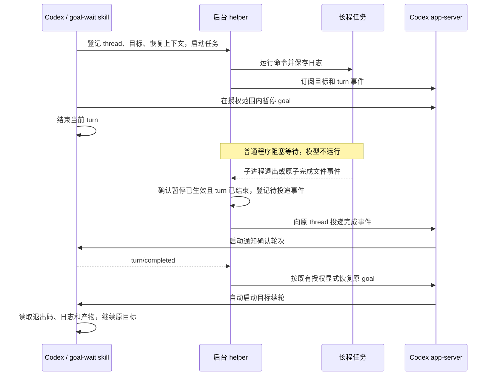

# goal-wait 可行性调研

调研日期：2026-10-20。目标环境：本机 Linux / WSL、Codex CLI 0.162.1，以及本机后台服务对应的 Codex 0.163.0。

**结论：核心方案可行。建议实现为 `goal-wait` skill + 独立后台 helper。`inotify` 可以完成无模型轮询的等待，但唤醒必须接入 Codex 的消息或 turn 接口；单独创建一个完成文件并不能唤醒会话。**

已验证两层结果：隔离模拟测试覆盖 0.162.1 和 0.163.0；0.163.0 上还完成了真实模型短测，走通“暂停 goal → 文件完成事件 → 通知轮次结束 → helper 恢复同一 goal → 自动续轮 → 执行并验证文件写入 → goal complete”。外部任务等待期间没有模型轮次。后续已据此实现本仓库的 skill；超过 20 分钟的稳定性长测尚未进行。

## 1. 已核实的能力

| 能力 | 证据 | 对设计的影响 |
| --- | --- | --- |
| `/goal` 支持暂停和恢复 | 官方命令文档列出 `/goal pause`、`/goal resume` | 无需删除目标或伪装成完成 |
| 外部程序可以管理 goal | 官方 app-server 文档提供 `thread/goal/get`、`thread/goal/set`、`thread/goal/clear` | helper 可以保存、暂停和恢复原目标 |
| 可以向指定会话投递消息 | 官方 CLI 文档提供 `codex queue --thread UUID --message TEXT` | 不需要模拟键盘输入或操作桌面 |
| 已加载的暂停会话可以被 queue 唤醒 | 本机 0.162.1、0.163.0 隔离测试均观察到新 turn | 可以结束当前 turn，在任务完成后再调用模型 |
| queue 不会自动恢复 goal | 实测新 turn 执行后，goal 仍为 `paused` | 必须单独恢复 goal，才能恢复后续自动推进 |
| app-server 接受自动暂停、恢复 | 两版本实测 `origin: "automatic"` 均成功 | 协议上可实现；仍须遵守用户授权和模型工具规则 |
| 通知后显式恢复会触发目标自动继续 | 两版本模拟测试，以及 0.163.0 真实模型短测完成目标 | helper 恢复 active 后不必再发送“继续”消息 |
| 后台 hook 完成不会启动新 turn | 官方 hooks 文档明确说明 | `async: true` hook 本身不足以实现唤醒 |
| 文件监听可以不调用模型 | Linux 原生 inotify 和 Node `fs.watch` 实测 | 等待可全部留在普通程序中 |

官方资料：

1. [Codex 命令、queue 与 /goal](https://learn.chatgpt.com/docs/developer-commands?surface=cli)，对应 `codex queue`、`Set or view a task goal with /goal`。
2. [Codex app-server](https://learn.chatgpt.com/docs/app-server)，对应 `Manage a thread goal`、`Start a turn`、`Unsubscribe from a loaded thread`、`Filesystem`。
3. [Hooks](https://developers.openai.com/codex/hooks/)，对应 `How background hooks run`。
4. [Skills](https://learn.chatgpt.com/docs/build-skills)，说明 skill 包含指令、资源和可选脚本，以及隐式匹配机制。

原 `developers.openai.com/codex/cli/reference/` 和 `/codex/app-server/` 在调研时重定向到上述 `learn.chatgpt.com` 页面。版本相关字段同时通过本机 `codex app-server generate-json-schema --experimental` 核验。

## 2. 要区分的三件事

**等待任务**：helper 使用子进程 `wait()` 或阻塞文件监听。这不需要模型参与。

**停止 goal 自动继续**：将目标置为 `paused`，随后结束当前 turn。只输出“等待中”而保持 goal 为 `active`，仍可能触发目标的自动续轮；暂停 goal 也不等于中断正在执行的 turn。

**唤醒并恢复推进**：向正确的 thread 投递事件，触发处理结果的一轮，再恢复目标状态。新 turn 已启动和 goal 已恢复是两个不同的状态。

因此，`command; touch done` 只解决完成信号。它还缺少独立等待进程、会话路由和 goal 生命周期管理。

## 3. 推荐架构



已验证的推荐顺序是：通知轮次先确认完成事件，helper 等该轮次 `turn/completed` 后恢复 active，后续自动续轮再处理结果并推进目标。模拟测试也通过了“通知轮次执行中恢复 active”，但该顺序尚未经过真实模型验证。不能假定投递与恢复两个请求是一个原子操作。

### skill 负责决策

- 对运行或预计剩余运行时间超过 20 分钟的外部任务考虑等待；只有其他可推进工作也已经做完时，才暂停整个 goal。
- 识别需要交互输入、定期调整参数的任务，这类任务不适合直接放置到结束。
- 调用 helper，保存后续要做什么、结果位置和成功条件。
- 暂停后结束本轮；由完成事件重新进入结果处理流程。
- 唤醒后检查实际结果，再继续原目标。

skill 的隐式匹配不是确定性的 slash-command 拦截器。若希望每次 `/goal` 都遵循该策略，应在用户的全局指令或项目 `AGENTS.md` 中明确启用，而不能只依赖描述里出现 `/goal`。

### helper 负责运行和事件

- 独立于当前 shell / tool 调用存活，管理子进程、日志、退出码和任务身份。
- 用子进程退出事件、`inotify` 或调度器事件阻塞等待。
- 持久化完成结果和待投递通知，管理去重与有限重试。
- 连接正确的 app-server；按 thread UUID 投递，避免用 `--last` 或易重名的标题。
- 订阅并协调目标暂停、turn 结束和任务完成事件，避免竞态。

最小结构可为：

```text
goal-wait/
  SKILL.md
  scripts/goal_wait.py
  references/codex-protocol.md
```

后续实现已提供 `start`、`status`、`cancel`、`reconcile` 及只读 `doctor` 入口，见 `skills/goal-wait/scripts/goal_wait.py`。

## 4. inotify 的适用位置

如果命令由 helper 启动，直接 `subprocess.Popen(...).wait()` 就可以在退出时收到通知。这比额外创建文件再监听更简单，同时能拿到退出码。

如果任务由其他程序运行，或者约定通过文件发布结果，再使用 `inotify`。本机没有安装 `inotifywait` 命令，但内核接口可用；调研使用 Python `ctypes` 直接调用原生接口完成验证，没有额外安装软件。

推荐发布方式：

1. 先监听任务目录，随后检查结果文件是否已经存在。
2. 任务将完整结果写入临时文件，再在同一文件系统内原子重命名为 `result.json`。
3. 监听目录的 `IN_MOVED_TO`，并只处理对应任务的文件名；同时根据事件后读取的持久化状态决定是否完成。

这样既能处理已经完成的任务，也能减少读到半写入 JSON 的机会。不要以日志增长或日志文件关闭作为完成依据。

完成结果至少保存：`job_id`、`thread_id`、`exit_code`、开始/结束时间、日志和产物路径。信号终止、启动失败和非零退出也应该形成结果并触发唤醒。包装器异常退出或被 `SIGKILL` 时不能指望 shell `trap` 总能执行，需要恢复检查将任务识别为丢失或中断。

对于远程训练、集群调度器或网络文件系统，应在任务所在主机等待，或使用调度器完成事件；不能假定本地 inotify 能可靠接收远端文件变化。Windows 原生环境需要其他文件事件实现；本次验证仅覆盖 Linux 环境。

## 5. 暂停和恢复的授权边界

当前会话中的 `update_goal` 工具说明要求“仅在用户明确要求时暂停”，并且该工具不能把 goal 从暂停改回 active。skill 文本本身不能覆盖这些上层规则。

你的需求已经明确提出自动暂停和恢复，因此这次可以研究这项行为。正式部署时，建议把长期授权写清楚，例如：

> 对预计剩余时间超过 20 分钟、且没有其他可推进工作的已授权任务，允许 goal-wait 暂停目标；由其登记的完成事件到达后，恢复同一目标并继续。后续取消或目标变更撤销自动恢复；明确撤销使用 `cancel JOB_UUID`。当前 API 缺少条件更新，不能保证识别每种并发或无变化的 UI 暂停。

helper 调用 app-server 时应保持真实来源 `origin: "automatic"`。本机 schema 对 `origin` 的注释是 “Missing provenance does not supply user authorization.” 不应伪装成用户操作来绕开限制。

目标状态更新可以只传 `threadId`、`status`、`origin`，不重写 objective。官方文档说明省略 objective 的状态更新会保留使用量记录。用户的预算限制、额度限制和后续停止指令仍然有效。

## 6. 两个必须处理的竞态

**任务先完成，goal 后暂停。** 如果完成通知立即唤醒，随后迟到的暂停可能把会话留在暂停状态。helper 必须保存完成事件，并等暂停已确认、原 turn 已结束后才进入通知流程。通过事件订阅和任务状态机实现，不依赖固定 sleep。

**用户改变目标后，旧任务完成。** 保存原目标身份和暂停记录；唤醒前检查当前状态及期间收到的目标变更。旧通知可以保留为结果，但不能恢复用户后来取消、修改或重新暂停的目标。单靠任务 PID 或目标字符串不足以区分所有情况，需要 helper 自身的任务代次和取消标记。

建议状态机：

```text
PREPARED → WAITING → RESULT_READY → WAKE_PENDING → ACKNOWLEDGED
                    ↘ CANCELLED / ORPHANED
```

进程退出、暂停确认、turn 完成可以以不同顺序到达。结果状态和通知状态应分开保存。通知至少一次投递，按 `job_id + event_generation` 去重；不要宣称跨 helper 与 Codex 两个系统天然具有 exactly-once 保证。

## 7. 会话加载和重启限制

本机 0.163.0 的一次重启测试观察到：

- 原会话状态为 `notLoaded`。
- `codex queue` 返回成功，完成消息持久化在队列中。
- 测量窗口内没有新增模型请求，会话仍为 `notLoaded`。

因此 `queue` 返回成功只表示投递成功，不能当作已经唤醒。进一步重启恢复探测遇到了 RPC 超时，尚未形成稳定的“服务重启后自动恢复”验证结果。

官方提供 `thread/resume` 加载会话，也提供 `turn/start`；本机 schema 还包含 `thread/queue/start`。这些是后续实现恢复适配器的入口，不代表任意顺序调用已经得到验证。正式实现必须分别处理 loaded/idle、active、notLoaded，并等待相应生命周期确认。

官方文档还说明：最后一个订阅者断开，且会话连续无活动 30 分钟后，app-server 可以卸载会话。这恰好覆盖本 skill 的目标时长，不能忽略。建议后台 helper 保留对目标会话的订阅，首版以后台服务持续运行作为支持条件。重启或断连后保留待投递结果，执行一次状态恢复检查；不要让模型不断尝试重连。

如果必须覆盖 app-server、终端、helper 甚至整机重启，应增加服务管理和持久化恢复协议，并单独验证。目前只能对核心运行链路给出可行结论。

## 8. 实测范围和数据

首轮测试使用独立临时 `CODEX_HOME`、独立 loopback app-server、本地模拟 Responses 服务，以及虚拟目标；未复制账号凭据。后续真实模型测试使用现有登录和默认模型、新建测试会话、独立 app-server 及临时工作目录，结束后归档测试会话。没有改变当前会话、持久配置或桌面 UI。

| 测试 | 观察 |
| --- | --- |
| 0.162.1 / 0.163.0 自动暂停、恢复 | `origin: automatic` 均返回预期状态 |
| 0.163.0 暂停后空闲 500ms | 模拟模型请求数 2 → 2 |
| 任务写入原子完成文件 | Node `fs.watch` 收到 rename，模型请求数仍为 2 |
| 随后执行 `codex queue` | 请求数 2 → 3，观察到 `turn/started` 和 `turn/completed` |
| 完成事件处理后 | goal 仍为 paused，验证恢复必须显式进行 |
| Linux 原生 inotify 阻塞等待 | 经过 2.024 秒，观察进程 CPU 约 0.000624 秒 |
| 一次服务重启后投递 | 返回成功但仍 notLoaded，消息留在队列中 |

首轮数据只验证进程和协议机制；完整恢复测试和真实模型短测见第 10 节。后续 helper 回归覆盖任务失败、提前完成、用户取消与断连。超过 20 分钟保持订阅，以及 helper / app-server 重启自动恢复尚未验证。

复现实验保存在 [experiments/probe.mjs](experiments/probe.mjs) 和 [experiments/inotify_probe.py](experiments/inotify_probe.py)。在本目录执行：

```bash
# 需要 Node.js 24、可用的 codex CLI；仅连接临时的本机模拟服务。
node experiments/probe.mjs

# Linux + Python 3；无需安装 inotifywait。
python3 experiments/inotify_probe.py
```

协议探针会创建独立临时目录和虚拟会话，输出事件与结果文件位置，不安装 skill。可以通过 `GOAL_WAIT_CODEX_BIN` 选择被测 app-server 二进制，通过 `GOAL_WAIT_OUTPUT` 指定结果 JSON 位置。探针覆盖持续运行的服务；前述重启结果属于额外探索，不包含在该探针的通过条件中。

token 节省来源是减少等待期间的模型轮次。例如等待一小时、每分钟让模型检查一次会产生约 60 次检查；后台等待可以把等待过程收敛为启动和结果处理所需的轮次。实际节省取决于模型、上下文、缓存和现有轮询频率，不能直接给出固定百分比。

## 9. 实施建议

首版已实现：本机 Linux、共享 app-server 持续运行、单个独立长程命令、显式用户授权、子进程退出事件、inotify 完成文件、持久化结果、保留会话订阅、一次完成唤醒和显式恢复目标。实现与安装入口见 [README.md](README.md)。

首版成功条件应是：等待期间没有模型请求；成功或失败结束后原 thread 收到一次可识别事件；结果处理后同一 goal 恢复推进；用户取消后不自动恢复。把服务重启自动恢复作为下一项单独验证的能力。

## 10. 补测：完成通知恢复 goal 并执行到完成

2026-10-20 补测已经验证完整闭环。关键是由 helper 显式恢复 goal，而不是只发通知。

### 推荐的已验证调用顺序

1. 外部任务发布完成文件，helper 收到事件。
2. 向仍加载的原会话投递完成通知，使用 `codex queue` 或 `thread/queue/add`。
3. 等待该通知轮次的 `turn/completed`；检查原目标仍然是 helper 负责的暂停目标。
4. helper 调用：

```json
{
  "id": 42,
  "method": "thread/goal/set",
  "params": {
    "threadId": "目标会话的 UUID",
    "status": "active",
    "origin": "automatic"
  }
}
```

5. 保持生命周期订阅。Codex 会自动启动下一轮，无须另外调用 `turn/start` 或再次发送“继续”。

第 4 步省略 objective 和 tokenBudget，保留原目标及其预算设置。测试也断言恢复后的 objective 和 createdAt 与暂停时相同。这里假设原目标仍可恢复，正式 helper 必须识别用户取消、改目标及预算限制。

### 对照测试结果

以下三个场景在 0.162.1 和 0.163.0 均通过。模型输出由本地 fixture 控制；文件写入和 `update_goal` 则确实经由 Codex 的工具执行路径完成。

| 操作 | 轮次数 | 最终 goal | 目标产物 |
| --- | --- | --- | --- |
| 只投递完成通知 | 1 | paused | 没有生成 |
| 通知轮次结束后恢复 active | 2 | complete | 文件内容为 `PASS` 加换行 |
| 通知轮次执行中恢复 active | 2 | complete | 文件内容为 `PASS` 加换行 |

正向场景中，一个轮次用于通知确认，另一个由 goal 自动调度；自动轮次执行 `exec_command` 写入文件、检查文件，再调用 `update_goal(status="complete")`。恢复 active 后没有再次发消息或调用 `turn/start`。只投递通知的反例采用 500ms 有界观察窗口。

### 真实模型短测

使用 0.163.0、本机默认模型 `gpt-6.1-sol`，结果如下：

- 目标初始为 paused；外部任务等待约 2 秒，期间 0 个模型轮次。
- 通知确认轮次返回 `ACK_ONLY`，目标仍为 paused，尚未生成文件。
- 约第 9.1 秒，helper 恢复原目标为 active。
- 同一会话立即自动开启新一轮，读取 `job-result.json`，写入并验证 `resumed-goal.txt`。
- 约第 27.4 秒目标变为 complete；约第 36.4 秒自动轮次正常结束。
- 文件字节内容确认为 `PASS\n`，objective 和 createdAt 保持一致。

这个结果证明真实模型能够沿该顺序恢复并完成短任务。它尚未证明 20 分钟以上的等待稳定性或服务重启后的恢复。

另外发现：`ephemeral: true` 的会话不支持 goal，服务器返回 `ephemeral thread does not support goals`。真实测试因此使用普通测试会话，完成后归档。

复现代码和结果：

- [模拟测试脚本](experiments/goal_resume_probe.mjs) 与 [脱敏证据摘要](experiments/evidence.json)。
- [真实模型短测脚本](experiments/live_goal_resume.mjs) 与 [脱敏证据摘要](experiments/evidence.json)。

```bash
# 本地模拟模型，不消耗真实模型额度。
node experiments/goal_resume_probe.mjs

# 使用当前配置的真实模型及既有登录；创建并在结束后归档测试会话。
node experiments/live_goal_resume.mjs
```

两个脚本都用事件订阅等待生命周期变化；超时仅用于让实验失败退出，没有模型驱动的状态轮询。

## 11. Skill 实现与安装验证

默认决策阈值现为预计剩余时间 **超过 20 分钟**。仓库采用 `skills/goal-wait/SKILL.md` 布局，Python helper 不依赖第三方库。Skills CLI 已在隔离项目目录成功发现并复制安装，安装后的脚本可独立运行。

新增 helper 回归使用真实 Codex 调度器、工具执行路径和本地模拟 Responses 服务，覆盖成功、非零退出、提前完成、命令启动失败、已有完成文件、原子重命名、无效任务 ID、取消、SIGTERM、目标修改、重新暂停和 app-server 断连。暂停期间不增加模型请求；正常恢复保持原 objective、createdAt 和预算。

0.163.0 的 `thread/resume` 会发送目标当前状态快照；该快照可能在下一次 RPC 后才被 helper 消费。实现按本次暂停事件划定订阅边界，避免把先前的 active 快照误判为新的用户恢复；暂停事件之后的变更仍撤销自动恢复。

可重复检查：`python3 -m unittest discover -s tests -v` 与 `node tests/integration.mjs`。原始本机运行数据保留在本地并由 `.gitignore` 排除；公开的 [evidence.json](experiments/evidence.json) 只保存脱敏观察摘要。未进行超过 20 分钟的稳定性长测，也不声称支持服务重启后的自动恢复。
