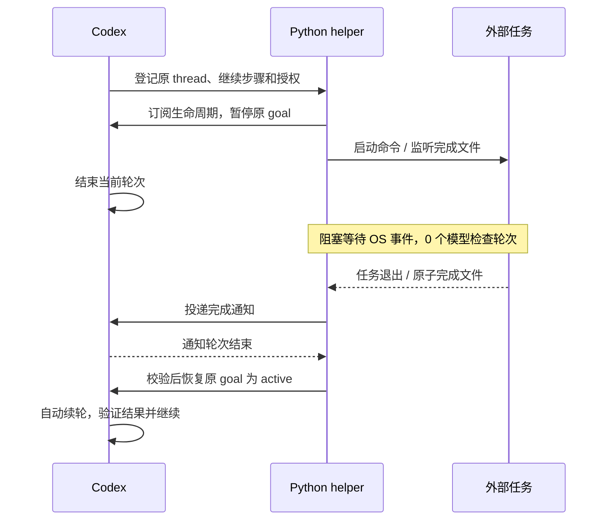

# goal-wait

让 Codex 的 `/goal` 在等待长程外部任务时停止模型轮询。默认在**预计剩余时间超过 20 分钟**、其他可推进工作已经完成时，暂停原 goal；后台 helper 通过子进程退出或 Linux inotify 等待，任务完成后发送通知，再显式恢复同一 goal。

helper 是普通 Python 后台程序，无第三方依赖，不是另一个 AI。

## 安装

本仓库采用 [skills.sh](https://skills.sh/) / [Skills CLI](https://github.com/vercel-labs/skills) 的标准 `skills/goal-wait/SKILL.md` 结构。安装所需 Node.js/npx；运行 helper 只需要 Linux/WSL 和 Python 3.10+。

在仓库目录安装到当前项目：

```bash
npx skills add . --skill goal-wait --agent codex -y
```

Git 仓库发布到 GitHub 后，也可以直接安装：

```bash
npx skills add AuncelFan/goal-wait --skill goal-wait --agent codex -g -y
```

远程命令依赖该 GitHub 仓库已发布；本地安装无需发布。安装只复制 skill，不安装服务、不改 Codex 配置，也不自动添加长期授权。

## 使用

需要同一个共享 Codex app-server 正在运行原会话；已验证协议版本为 0.162.1、0.163.0。单独启动另一个 app-server 不能唤醒原会话。

在已有 `/goal` 的会话里明确授权：

> 使用 $goal-wait。如果已授权任务预计还需要超过 20 分钟，且没有其他可推进工作，允许暂停当前 goal，任务结束后自动恢复并继续。

Codex 会调用 skill 附带的 helper，保存继续步骤并结束当前轮次。任务完成后，先发生一个短通知确认轮次，再恢复 goal 自动推进；任务失败也会通知，由 Codex 检查退出码、日志和产物。

若希望所有 `/goal` 都遵循此策略，可把 [长期授权示例](skills/goal-wait/references/workflow.md#standing-authorization) 加入你自己的全局指令或项目 `AGENTS.md`。仅安装 skill 不能保证每次隐式选择，也不能覆盖上层工具的授权规则。



## 诊断和取消

以下路径以本仓库为例；安装后使用 skill 实际目录：

```bash
python3 skills/goal-wait/scripts/goal_wait.py doctor --thread "$CODEX_THREAD_ID"
python3 skills/goal-wait/scripts/goal_wait.py status JOB_UUID
python3 skills/goal-wait/scripts/goal_wait.py cancel JOB_UUID
python3 skills/goal-wait/scripts/goal_wait.py cancel JOB_UUID --terminate
python3 skills/goal-wait/scripts/goal_wait.py reconcile JOB_UUID
```

状态与日志默认保存在 `~/.local/state/goal-wait`，权限 0700。`cancel` 取消自动唤醒，保留正在运行的任务；`--terminate` 额外向 helper 启动的命令进程组发送 SIGTERM。取消后原 goal 仍暂停，按用户后续指令处理。

默认连接 `${CODEX_HOME:-~/.codex}/app-server-control/app-server-control.sock`，可用 `GOAL_WAIT_ENDPOINT` 或 `--endpoint` 指定实际 socket/loopback WebSocket。外部完成文件、参数及恢复流程见 [workflow.md](skills/goal-wait/references/workflow.md)。

## 当前边界

首版要求本地 Linux/WSL、helper 和原 app-server 持续运行。断连、重启或丢失目标所有权时保留结果，停止自动恢复，交由用户决定；不提供重启后自动恢复。API 没有条件更新/所有权锁，无法保证识别每种并发或无变化的 UI 暂停；使用 `cancel JOB_UUID` 可明确撤销。没有自动创建 goal、hook 轮询或桌面操作。

之前已用真实模型验证完整通知和恢复链路。新 helper 在 0.162.1、0.163.0 上各通过 12 个集成场景，另有 7 个单元测试通过；回归使用隔离 Codex 配置和本地模拟模型，不消耗真实模型额度。尚未进行超过 20 分钟的稳定性长测。

```bash
python3 -m unittest discover -s tests -v
node tests/integration.mjs
```

[可行性调研与历史实验](FEASIBILITY.md) 保留协议依据；未脱敏的本地原始结果不纳入 Git。
